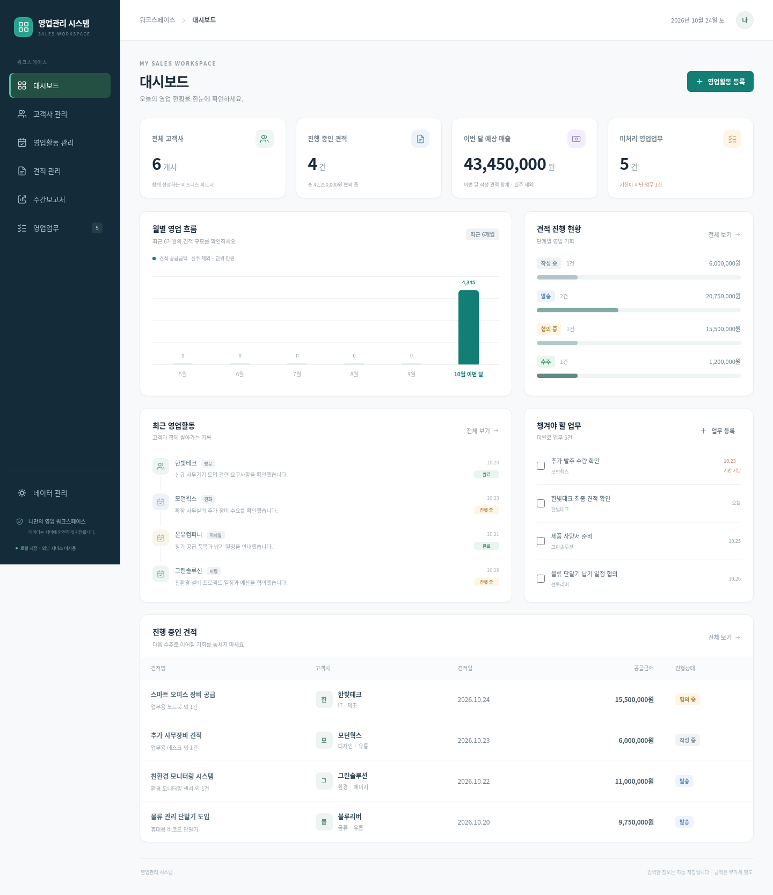

# 영업관리 시스템

고객사, 영업활동, 견적과 주간보고서를 한곳에서 관리하는 한국어 업무용 프로그램입니다. 흰색 배경의 화면에서 샘플 데이터로 사용법을 익힐 수 있습니다.

Python만 설치하면 실행됩니다. 별도 유료 서비스, 회원가입, 데이터베이스 설치, `pip`·`npm` 패키지 설치가 필요하지 않습니다.

## 화면 미리보기

아래 이미지는 샘플 데이터로 실행한 실제 화면입니다.



[주간보고서 화면](docs/weekly-report.png) · [모바일 화면](docs/mobile-preview.png)

## 1. 내 컴퓨터에서 처음 실행하기

### Windows

1. Windows 10/11에서는 [Python 공식 홈페이지](https://www.python.org/downloads/)에서 Python 3.10 이상을 설치합니다. **Windows 8.1은 [Python 3.12.10 설치 파일](https://www.python.org/ftp/python/3.12.10/python-3.12.10-amd64.exe)**을 사용하세요. 설치 첫 화면의 **Add python.exe to PATH** 항목을 선택하면 편리합니다. 체크하지 않았더라도 Python 런처 또는 기본 설치 경로를 통해 실행할 수 있습니다.
2. GitHub 저장소에서 **Code → Download ZIP**을 눌러 프로그램을 내려받습니다. ZIP 파일을 마우스 오른쪽 버튼으로 눌러 **압축 풀기**를 실행하세요. ZIP 파일 안에서 바로 실행하지 마세요.
3. 압축을 푼 폴더 안에서 **start.bat** 파일을 더블 클릭합니다.
4. 검은색 실행 창을 그대로 둔 상태에서 Chrome이나 Edge를 열고 주소창에 **http://localhost:3000** 을 입력합니다. 이 주소는 프로그램을 실행한 내 컴퓨터에서 접속하는 주소입니다.

화면이 열리면 바로 샘플 데이터를 사용할 수 있습니다. 다음부터는 같은 폴더의 `start.bat`를 실행하면 됩니다.

`start.bat` 대신 명령어로 실행하려면 프로그램 폴더에서 터미널을 열고 다음을 입력하세요.

```console
python server.py
```

### macOS / Linux

1. Python 3.10 이상을 준비합니다. macOS는 [Python 공식 홈페이지](https://www.python.org/downloads/)의 설치 프로그램을 사용할 수 있습니다.
2. GitHub에서 **Code → Download ZIP**을 눌러 내려받고 압축을 풉니다.
3. 터미널에서 압축을 푼 폴더로 이동한 뒤 실행합니다. 아래 경로는 실제 폴더 경로로 바꾸세요.

```bash
cd ~/Downloads/sales-management-main
bash start.sh
```

직접 실행하려면 `python3 server.py`를 입력해도 됩니다. 브라우저 주소창에 **http://localhost:3000** 을 입력하세요.

### 실행 창과 종료 방법

- 프로그램을 사용하는 동안 실행 창을 열어 두세요. 창을 닫으면 프로그램도 종료됩니다.
- 종료할 때는 실행 창을 선택하고 **Ctrl+C**를 누릅니다.
- 다시 실행하면 이전에 저장한 데이터를 불러옵니다.
- `3000` 포트를 이미 사용 중이라는 오류가 나오면 `python server.py --port 3001`로 실행하고 브라우저에서 `http://localhost:3001`로 접속하세요. macOS/Linux에서는 `python3`를 사용합니다.

## 2. 화면 사용하기

| 화면 | 할 수 있는 일 |
| --- | --- |
| 대시보드 | 전체 고객사 수, 진행 중인 견적 수, 이번 달 예상 매출, 미처리 업무를 확인합니다. |
| 고객사 관리 | 고객사명·담당자·연락처·주소를 등록하고 검색·수정합니다. 고객사별 영업활동과 견적 이력을 확인합니다. |
| 영업활동 | 방문·전화·이메일·미팅 내용을 기록하고, 다음 진행사항과 예정일, 진행상태를 관리합니다. |
| 견적 관리 | 여러 제품의 이름·수량·공급단가를 입력합니다. 공급금액과 합계가 자동 계산되며 견적상태를 관리할 수 있습니다. |
| 영업업무 | 기한이 있는 할 일을 등록·수정하고 체크박스로 완료 처리합니다. |
| 주간보고서 | 선택한 주의 영업활동, 진행 중인 견적, 다음 주 예정 업무를 확인하고 실제 Excel 파일(`.xlsx`)로 내려받습니다. |
| 데이터 관리 | 데이터를 JSON 파일로 백업하거나 이전 백업을 불러옵니다. |

견적 금액은 **부가세를 제외한 공급가액**입니다. 대시보드의 이번 달 예상 매출은 이번 달 작성한 견적 중 실주를 제외한 합계이며, 실제 입금액과는 다릅니다. 주간보고서는 **월요일부터 일요일**까지를 한 주로 집계합니다. 고객사에 연결된 활동·견적·업무가 있다면 이력을 보호하기 위해 고객사 삭제가 제한됩니다.

처음 표시되는 고객사명·담당자·연락처 등은 사용 연습을 위한 가상 정보입니다. 데이터베이스를 처음 만들 때만 샘플이 등록되며, 재실행할 때마다 중복 추가되지 않습니다.

## 3. 저장, 백업과 복원

등록·수정 화면에서 **저장**을 누르거나 업무 완료 상태를 변경하면 실행 중인 서버의 데이터베이스에 즉시 저장됩니다. 브라우저를 닫거나 프로그램을 재시작해도 데이터가 유지됩니다.

- 저장 파일: 프로그램 폴더 안의 **data/sales.db**
- 저장 위치는 브라우저가 아니라 **프로그램을 실행한 컴퓨터**입니다.
- 폴더 전체를 지우면 저장 파일도 지워지므로, 중요한 내용은 따로 백업하세요.

### 권장 백업 방법

1. 프로그램의 **데이터 관리** 화면에서 **백업 파일 다운로드**를 누릅니다.
2. 내려받은 JSON 파일을 안전한 폴더나 USB 등에 보관합니다.
3. 다른 컴퓨터로 옮길 때는 그 컴퓨터에서 프로그램을 실행한 후 **데이터 관리** 화면의 **백업 파일 선택**을 이용합니다.

백업 불러오기는 **현재 데이터를 백업 파일의 내용으로 교체**합니다. 화면의 확인 안내를 읽고 진행하세요. 복원하기 전에 현재 자료도 먼저 백업하는 것이 좋습니다.

데이터베이스 파일을 직접 복사하려면 프로그램을 **Ctrl+C로 완전히 종료한 후** `data/sales.db`를 복사하세요. 실행 중인 파일을 임의로 바꾸지 마세요.

## 4. 클라우드 환경에서 확인하기

클라우드 터미널에서 아래 명령으로 실행합니다.

```bash
cd /workspace/sales-management
python3 server.py
```

서버는 기본적으로 **3000번 포트**를 사용합니다. 클라우드 서비스에 포트 미리보기 또는 포트 전달 기능이 있으면 3000번 포트로 연결하세요. 서비스가 제공한 접속 주소를 사용해야 하며, 내 컴퓨터 브라우저의 `localhost:3000`은 원격 클라우드 서버를 가리키지 않습니다.

미리보기 기능을 제공하지 않는 환경에서는 저장소를 내 컴퓨터에 내려받아 위의 실행 방법으로 확인할 수 있습니다.

## 5. 자주 발생하는 문제

| 증상 | 해결 방법 |
| --- | --- |
| 실행 창에 `cho`, `se` 등의 명령 오류가 반복됨 | 최신 `start.bat`로 교체하세요. 이전 실행 파일의 문자 인코딩/줄바꿈 문제를 수정했습니다. 임시로 프로그램 폴더 주소창에 `cmd`를 입력해 연 뒤 `py -3 server.py`를 실행할 수 있습니다. |
| Python을 찾을 수 없다는 메시지 | Python을 설치하고 **Add python.exe to PATH**를 선택했는지 확인합니다. 설치 후 실행 창을 새로 열어 다시 시도하세요. |
| 브라우저에 연결할 수 없다고 표시 | 실행 창에 오류가 없는지, 창이 계속 열려 있는지, 주소와 포트 번호가 맞는지 확인합니다. |
| 다른 폴더에서 실행하면 파일이 없다고 표시 | `server.py`가 들어 있는 폴더에서 실행하거나 `start.bat` / `start.sh`를 사용하세요. |
| 다시 받으니 이전 자료가 사라짐 | 새로 받은 폴더는 별도의 저장 공간을 사용합니다. 이전 폴더의 백업을 불러오세요. |

이 버전은 **한 사람이 사용하는 로컬 업무 도구**입니다. 로그인과 사용자별 권한 기능은 없습니다. 실제 고객정보를 사용하기 전에 접근을 제한하고, 인증 없이 인터넷에 공개하지 마세요.

## 개발 및 검증

Python 표준 라이브러리의 HTTP 서버와 SQLite를 사용합니다. 외부 서버에 고객 데이터를 전송하지 않습니다.

```bash
python3 -m unittest discover -s tests -v
```

테스트는 임시 데이터베이스로 실행되며 평소 사용하는 `data/sales.db`와 분리됩니다.

선택 사항: 개발자가 실제 브라우저로 검증하려면 Playwright와 Chromium을 준비한 뒤 `python3 tests/browser_smoke.py`를 실행할 수 있습니다. 이 도구는 개발 검증에만 사용하며 프로그램 이용에 설치할 필요가 없습니다.
